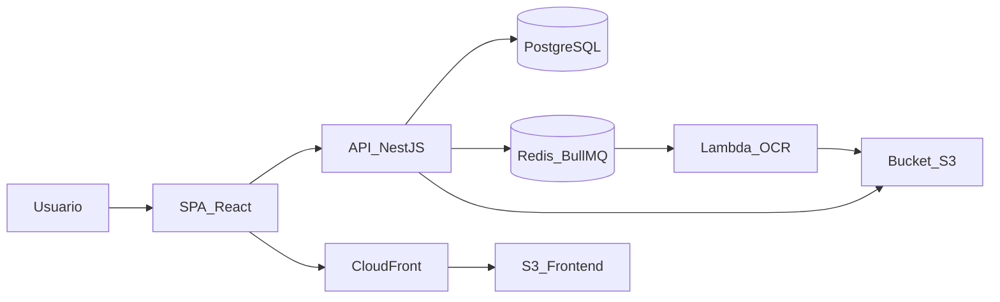

# Case Study — Sistema de Compras Corporativo

Case study documental e anônimo de um sistema full-stack de compras corporativas: solicitações, fluxos de aprovação, anexos em armazenamento objeto e auditoria. Os snippets são **ilustrativos e reescritos** — não são código de produção nem de um cliente específico.

> **Aviso:** este repositório não contém secrets, ARNs, seeds, logos ou dados reais. Nomes e domínios de empregadores/clientes foram omitidos de propósito.

## Problema de negócio

Empresas de médio e grande porte precisam registrar pedidos de compra, encaminhá-los por cadeias de aprovação (valores, centros de custo, alçadas), anexar documentos (cotações, notas, contratos) e manter rastreabilidade para auditoria. Sem um fluxo único, o processo fica espalhado em e-mail e planilhas, com risco de perda de anexos e baixa visibilidade do status.

Este case modela uma solução que centraliza:

- criação e acompanhamento de **solicitações de compra**;
- **máquina de estados** de aprovação com papéis distintos;
- **anexos** via upload direto para armazenamento objeto (URLs pré-assinadas);
- **permissões** consistentes entre API e SPA;
- jobs assíncronos (ex.: OCR de documentos) sem bloquear a API.

## Papel

Atuação **full-stack / arquitetura / documentação**: definição de módulos no backend, contrato de upload/download, RBAC na SPA, pipeline de deploy e metodologia de docs com ADRs e guias por perfil.

## Stack

| Camada | Tecnologias |
|--------|-------------|
| Backend | NestJS, TypeORM, PostgreSQL, BullMQ (Redis), JWT/RBAC |
| Frontend | React 19, Vite, TanStack Query, Zod + React Hook Form, Tailwind / shadcn |
| Armazenamento | AWS S3, CloudFront, URLs pré-assinadas |
| Processamento | Lambda (OCR), filas Redis |
| Infra / CI | Terraform (conceitual), GitHub Actions, API em ECS, front estático em S3/CloudFront |

## Visão de arquitetura




## Destaques técnicos (4 pilares)

1. **Monolito modular NestJS** — domínios (solicitações, fluxo, arquivos, auth) isolados em módulos, com um único deploy previsível para o estágio do produto.
2. **Uploads com URLs pré-assinadas** — a SPA sobe arquivos direto no S3; a API só emite credenciais temporárias e persiste metadados, reduzindo carga e superfície de ataque.
3. **RBAC alinhado front ↔ API** — rotas lazy protegidas por `PermissionRoute` e guards no backend com as mesmas chaves de permissão.
4. **Documentação rastreável** — ADRs, guias por perfil e prefixos de docs para decisões e procedimentos não se misturarem.

## Documentação

| Documento | Conteúdo |
|-----------|----------|
| [Arquitetura](./docs/arquitetura.md) | Camadas, deploy, filas |
| [Backend](./docs/backend.md) | Módulos, JWT/RBAC, BullMQ |
| [Frontend](./docs/frontend.md) | Features, Query, formulários, rotas |
| [Armazenamento S3](./docs/armazenamento-s3.md) | Upload, metadados, OCR |
| [Documentação](./docs/documentacao.md) | Metodologia e camadas de docs |
| [ADRs](./docs/decisoes/) | Decisões de arquitetura |

## Snippets ilustrativos

| Área | Arquivos |
|------|----------|
| Backend | [`files.service.ts`](./snippets/backend/files.service.ts), [`permissions.guard.ts`](./snippets/backend/permissions.guard.ts), [`approval-state-machine.ts`](./snippets/backend/approval-state-machine.ts) |
| Frontend | [`use-requests-query.ts`](./snippets/frontend/use-requests-query.ts), [`permission-route.tsx`](./snippets/frontend/permission-route.tsx), [`upload-attachments.ts`](./snippets/frontend/upload-attachments.ts) |
| Infra | [`github-actions-cd.exemplo.yml`](./snippets/infra/github-actions-cd.exemplo.yml), [`notas-s3-cloudfront.md`](./snippets/infra/notas-s3-cloudfront.md) |

## Licença

MIT — veja [LICENSE](./LICENSE).

## Publicação

O repositório foi preparado localmente. Para publicar no GitHub (quando desejar):

```bash
cd ~/Documentos/portfolio-sistema-compras-corporativo
gh repo create case-sistema-compras-corporativo --public --source=. --remote=origin --push
```

Ou, com remote manual:

```bash
git remote add origin git@github.com:<seu-usuario>/case-sistema-compras-corporativo.git
git push -u origin main
```
