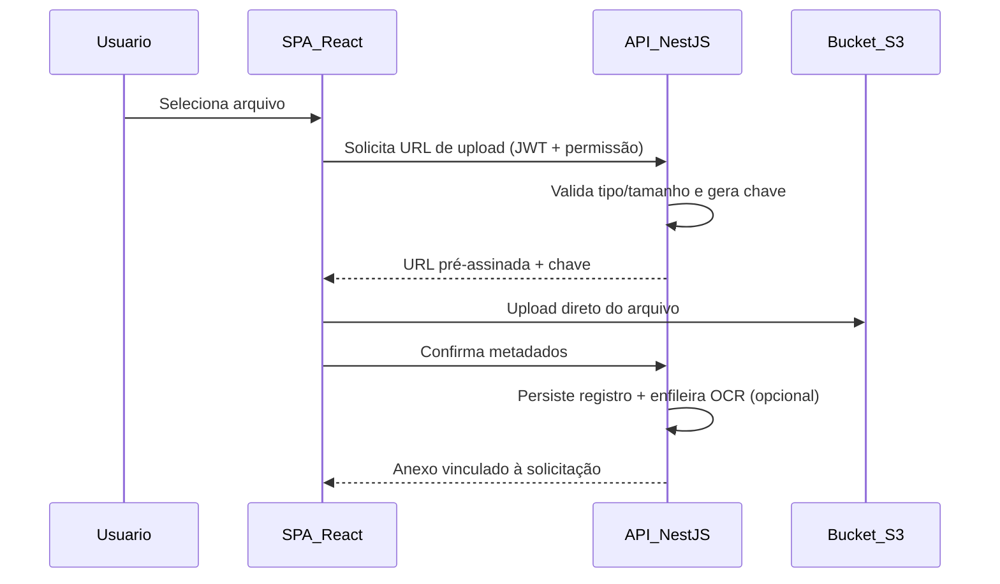

# Armazenamento S3

Como anexos de solicitações de compra são enviados, armazenados e lidos — e como entra o OCR opcional.

## Princípios

1. **Binário fora do banco** — PostgreSQL guarda metadados; o objeto fica no S3.
2. **Sem chaves permanentes no browser** — apenas URLs pré-assinadas de curta duração.
3. **API como porteiro** — valida permissão, gera a URL, registra o vínculo à solicitação.
4. **Buckets separados conceitualmente** — anexos privados ≠ assets públicos do frontend.

## Fluxo de upload

## Metadados tipicos

| Campo | Uso |
|-------|-----|
| `id` | Identificador interno |
| `requestId` | Solicitação dona do anexo |
| `storageKey` | Chave no bucket |
| `fileName` | Nome original (sanitizado na exibição) |
| `contentType` | MIME permitido |
| `sizeBytes` | Limite validado na emissão da URL |
| `ocrStatus` | `PENDING` / `DONE` / `FAILED` / `SKIPPED` |

## Download

Mesmo padrão: API verifica se o usuário pode ver a solicitação; emite URL pré-assinada de leitura com TTL curto; SPA abre ou baixa via essa URL. Objetos permanecem privados (sem ACL pública).

## OCR (Lambda)

Quando um anexo elegível é confirmado:

1. job entra na fila Redis/BullMQ;
2. worker ou Lambda lê o objeto no S3;
3. texto/extração é persistido (ou status de falha);
4. a SPA reflete `ocrStatus` via polling ou invalidação de query.

A Lambda **não** precisa ser chamada sincronamente pela request HTTP do usuário.

## Frontend estático

O build da SPA vai para outro prefixo/bucket, exposto via **CloudFront**. Invalidação de cache no deploy do `index.html`. Notas em `snippets/infra/notas-s3-cloudfront.md`.

## Decisão relacionada

Ver [ADR 002 — Uploads pré-assinados](./decisoes/002-uploads-presigned.md).
